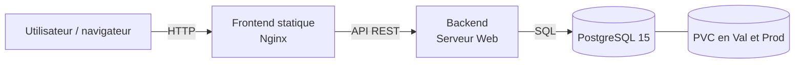

<div align="center">

# Application 3-Tiers Conteneurisée
### Déploiement Dev · Val · Prod avec Docker, Kubernetes et GitHub Actions

Projet académique de groupe réalisé dans le cadre du module **DevOps**.


</div>

## Sommaire

- [Présentation](#-présentation)
- [Architecture](#-architecture-cible)
- [Services et ports](#-services-et-ports)
- [Environnements et promotion](#-environnements-et-promotion)
- [Workflow CI/CD](#-workflow-cicd)
- [Structure du dépôt](#-structure-du-dépôt)
- [Démarrage rapide](#-démarrage-rapide)
- [Configuration](#-configuration)
- [Équipe et responsabilités](#-équipe-et-responsabilités)
- [État et limites connues](#-état-et-limites-connues)

## 🎯 Présentation

L’objectif du projet est de concevoir et d’industrialiser une application Web
en trois couches — **interface utilisateur, API métier et base de données** —
puis de l’exécuter dans des environnements distincts :

| Environnement | Usage | Exécution cible |
|---|---|---|
| **Dev** | Développement et tests locaux | Docker Compose, sur le poste de chaque membre |
| **Val** | Validation intégrée avant livraison | Kubernetes, namespace `val` |
| **Prod** | Version destinée à la production | Kubernetes, namespace `prod` |

Le projet vise à mettre en pratique la conteneurisation Docker, l’orchestration
Kubernetes, la gestion de configuration, la persistance des données et la
promotion contrôlée des changements au moyen de branches et de Pull Requests.

## 🏗️ Architecture cible



Les trois composants ont des responsabilités séparées :

1. **Frontend** — interface Web statique servie par Nginx ; elle appelle l’API
   backend.
2. **Backend** — API REST qui porte la logique métier et accède aux données.
   Le framework reste à préciser dans le dépôt (Flask, Express ou Spring Boot
   sont des options envisagées).
3. **Database** — PostgreSQL 15, avec stockage persistant visé au moyen de
   PersistentVolumeClaims (PVC) dans les environnements Kubernetes Val et Prod.

Routes applicatives prévues :

| Méthode | Route | Rôle |
|---|---|---|
| `GET` | `/items` | Lire la collection d’éléments |
| `POST` | `/items` | Ajouter un élément |

Le schéma des données, le format JSON des réponses et les règles de validation
doivent être définis avec l’implémentation de l’API.

## 🔌 Services et ports

Les ports ci-dessous sont les ports de service usuels ou prévus ; les ports
réellement exposés doivent être confirmés dans les Dockerfiles et les Services
Kubernetes.

| Composant | Port conteneur / service indicatif | Accès |
|---|---:|---|
| Frontend Nginx | `80/TCP` | Navigateur via le port hôte en Dev ou un Service/Ingress en K8s |
| API Backend | À définir selon le framework | Depuis le frontend et les autres composants du cluster |
| PostgreSQL | `5432/TCP` | Interne au réseau Compose ou au cluster ; ne pas exposer publiquement |
| NodePort / Ingress | À configurer | Point d’entrée externe de Val et Prod |

> Les valeurs `localhost`, NodePort, domaines et URLs publiques ne sont pas
> renseignés dans le dépôt. Ils ne sont donc pas inventés ici.

## 🔀 Environnements et promotion

Chaque environnement correspond à une étape de validation. Les changements
progressent par Pull Requests, plutôt que d’être développés directement sur
`main`.

| Branche cible | Environnement associé | Déploiement cible |
|---|---|---|
| `dev` | Dev | Tests locaux avec Docker Compose |
| `val` | Val | Namespace Kubernetes `val` |
| `main` | Prod | Namespace Kubernetes `prod` |

Cycle de vie d’une fonctionnalité :

```text
Branche feature/*
        │
        ▼ Pull Request
      dev ── tests et intégration locale
        │
        ▼ Pull Request
      val ── validation sur Kubernetes (namespace val)
        │
        ▼ Pull Request
      main ── livraison sur Kubernetes (namespace prod)
```

Le groupe prévoit **neuf fonctionnalités**, soit trois par membre. Les
descriptions précises des neuf fonctionnalités et leurs critères d’acceptation
restent à documenter au fur et à mesure de leur implémentation.

### Isolation Kubernetes

Val et Prod sont isolés dans des namespaces distincts (`val` et `prod`) sur le
cluster Minikube hébergé par le membre responsable de l’orchestration. Les
manifestes de chaque environnement doivent être appliqués dans le namespace
correspondant. La création effective des namespaces, les règles réseau et les
mécanismes d’exposition dépendent des manifestes à ajouter.

## ⚙️ Workflow CI/CD

Le fichier [`.github/workflows/ci-cd.yml`](.github/workflows/ci-cd.yml) déclare
des déclencheurs sur les `push` et Pull Requests vers `dev`, `val` et `main`.
Il prévoit la construction et la publication d’images Docker Hub avec un tag
d’environnement (`dev`, `val` ou `prod`) et un tag correspondant au SHA du
commit.

Secrets GitHub attendus par le workflow :

| Secret | Utilisation |
|---|---|
| `DOCKERHUB_USERNAME` | Identifiant du compte Docker Hub |
| `DOCKERHUB_TOKEN` | Jeton utilisé pour l’authentification Docker Hub |

> **Limite à résoudre avant d’annoncer un déploiement automatisé :** le workflow
> actuel ne contient aucune étape `kubectl` ni action de déploiement. Il
> référence également `./database` comme contexte de build, alors que ce
> répertoire n’existe pas dans l’arborescence inspectée. Enfin, la publication
> des images est activée dans le job déclenché aussi par Pull Request ; ce
> comportement est à vérifier et à restreindre selon la politique du dépôt.
> Le pipeline de build/push ne constitue donc pas, à lui seul, un déploiement
> Kubernetes Dev/Val/Prod.

## 🗂️ Structure du dépôt

```text
TP_DevOps/
├── backend/
│   ├── Dockerfile                 # Squelette, runtime à définir
│   └── .gitkeep
├── frontend/
│   ├── Dockerfile                 # Squelette, build/serveur à définir
│   └── .gitkeep
├── k8s/
│   ├── val/                       # Manifestes à ajouter
│   │   └── .gitkeep
│   └── prod/                      # Manifestes à ajouter
│       └── .gitkeep
├── .github/
│   └── workflows/
│       ├── ci-cd.yml              # Build et publication d’images déclarés
│       └── .gitkeep
├── docker-compose.yml             # Squelette ; aucun service déclaré
└── README.md
```

La couche base de données, les scripts SQL d’initialisation et les manifestes
Kubernetes (Deployments/StatefulSet, Services, ConfigMaps, Secrets et PVC)
doivent encore être ajoutés au dépôt inspecté.

## 🚀 Démarrage rapide

### Prérequis

- Git
- Docker Engine et le plugin Docker Compose
- `kubectl`
- Minikube (pour Val et Prod)
- Accès au dépôt GitHub et, pour le workflow de publication, un compte Docker Hub

### Dev — Docker Compose

À la racine du dépôt :

```bash
docker compose up --build
```

Pour arrêter les conteneurs :

```bash
docker compose down
```

**État actuel :** `docker-compose.yml` contient `services: {}` ; aucun service
n’est encore configuré. Les Dockerfiles backend et frontend sont également des
squelettes. Ces commandes ne démarreront l’application qu’après ajout des
services, du code et des instructions de build.

### Val et Prod — Minikube et Kubernetes

Démarrer Minikube et vérifier l’accès au cluster :

```bash
minikube start
kubectl get nodes
```

Créer les namespaces s’ils n’existent pas, puis appliquer les manifestes :

```bash
kubectl create namespace val --dry-run=client -o yaml | kubectl apply -f -
kubectl apply -f k8s/val/ -n val

kubectl create namespace prod --dry-run=client -o yaml | kubectl apply -f -
kubectl apply -f k8s/prod/ -n prod
```

Vérifier ensuite les ressources :

```bash
kubectl get all -n val
kubectl get pvc -n val

kubectl get all -n prod
kubectl get pvc -n prod
```

Les dossiers `k8s/val/` et `k8s/prod/` ne contiennent actuellement aucun
manifeste. Les commandes `kubectl apply` ne déploieront rien avant leur ajout.
L’application locale de manifestes ne déclenche pas non plus le workflow
GitHub Actions ; ce comportement doit être implémenté et configuré séparément.

### URLs des environnements

| Environnement | URL |
|---|---|
| Dev | À définir après configuration des ports Compose |
| Val | À définir après configuration du Service ou de l’Ingress |
| Prod | À définir après configuration du Service ou de l’Ingress |

## 🔐 Configuration et bonnes pratiques

- Stocker les identifiants Docker Hub dans les **GitHub Actions Secrets** ;
  ne jamais commiter de jeton ou de mot de passe.
- Injecter les paramètres de connexion à PostgreSQL par variables
  d’environnement ou Secrets Kubernetes ; ne pas les coder en dur dans une
  image.
- Garder PostgreSQL sur un réseau interne et persister ses données avec un PVC
  en Val et Prod.
- Éviter les tags d’image uniquement mutables (`dev`, `val`, `prod`) comme
  unique référence de déploiement ; conserver une référence immuable, par
  exemple le SHA du commit.
- Définir les contrôles de santé, limites de ressources, stratégies de mise à
  jour et politiques de sauvegarde avant une mise en production réelle.

## 👥 Équipe et responsabilités

Les noms des trois étudiants ne sont pas fournis dans le dépôt ; les rôles sont
donc présentés par numéro de membre.

| Membre | Responsabilités principales | Livrables associés |
|---|---|---|
| **Membre 1 — BDD & infrastructure Git/Docker** | Dépôt GitHub public, protections des branches `dev`, `val` et `main`, compte Docker Hub partagé, couche de données et Feature 1 | PostgreSQL, scripts SQL, manifestes de base de données et PVC |
| **Membre 2 — Backend & CI/CD** | API et connexion BDD, workflow GitHub Actions, logique métier et Feature 2 | Routes REST, Deployment/Service/ConfigMap backend, pipeline CI/CD |
| **Membre 3 — Frontend & orchestration Val/Prod** | Interface utilisateur, cluster Minikube, isolation des namespaces, exposition et tests de bout en bout, Feature 3 | Frontend, manifestes associés, NodePort/Ingress et tests E2E |

